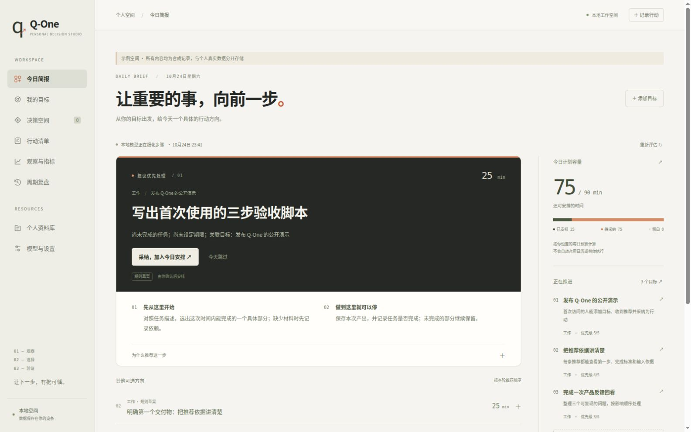

# Q-One · 个人决策工作台

**保存目标 → 系统自动推荐下一步 → 采纳为今日重点 → 完成行动 → 自动调整后续建议。**

这是本项目独立交付的一套完整个人应用，包含中文界面、本地数据存储、真实模型接口和备份恢复。`q-one-core`、`q-one-agent` 是它的内部依赖；三个仓库不代表用户要求的三个独立方案。其他 AI 的实现不在本次交付范围内。



v0.4 首页以一个优先行动为中心：具体第一步、完成标准、可展开的依据，以及当天的安排与时间容量。其他建议收为备选项。详见 [Decision Studio 改版与验收](docs/DECISION_STUDIO.zh-CN.md)。

## 自动推荐怎样工作

只需先保存一个目标及完成标准。你不需要先创建决策、填写备选方案或点击“获取建议”。服务启动、目标/任务/近期观察变化以及跨日时，后台会检查当前状态并自动更新推荐，首页自动显示结果。

- 默认使用本机 Ollama 生成具体小步骤，也可选 Laya 对已有候选排序。
- 每条推荐展示行动、第一步、完成标准、预计投入时间、依据和来源；采纳后加入今日重点，完成后继续推荐下一步。
- 设置每日可安排时间，已采纳的时间会从当天预算扣除；“今天忽略”的项目当天不重复打扰，相关目标或进展改变后可重新参与推荐。
- 本地模型失败时明确显示规则建议与原因；数据不变时缓存结果，默认6小时重评，失败后至少5分钟再试。
- 自动推荐在**服务运行期间**工作。网页关闭后后台仍运行；停止程序后暂停调度。远程模型沿用手动预览确认流程，不自动上传个人目标。

初始每日90分钟只是可修改的计划预算，不是系统测量到的真实空闲时间。现有决策空间继续保留，用于你希望明确比较选项、保存事前判断和回看结果的事项。

## 在本机运行

已实测 Linux + Python 3.12。代码要求 Python 3.10 及以上；Windows 原生并发文件锁尚未验证，建议使用 WSL。无需前端构建工具或在线账号。

```bash
git clone https://github.com/aidless/q-one-life.git
cd q-one-life
bash scripts/setup.sh
bash scripts/run.sh
```

浏览器打开 **http://127.0.0.1:8765**。在启动窗口按 **Ctrl+C** 停止，下次运行数据会保留。安装脚本优先使用已安装的 uv，否则使用 pip；先安装固定提交的两个内部依赖，再安装本应用。默认运行环境位于 `~/.local/share/q-one-runtime/venv`，个人数据位于 `~/.local/share/q-one`，都在仓库外。

```bash
# 自定义运行环境、数据目录或端口
QONE_VENV="$HOME/.venvs/qone" bash scripts/setup.sh
QONE_VENV="$HOME/.venvs/qone" QONE_HOME="$HOME/qone-private" bash scripts/run.sh --port 8766
```

没有模型也能完整记录自己的判断、任务、观察和复盘。模型失败会显示错误并保留记录。

## 选择模型

- **Ollama**：安装并启动 [Ollama](https://docs.ollama.com/quickstart)，下载适合自己机器的模型。默认地址 `http://127.0.0.1:11434`、默认名称 `qwen3:8b`，可在设置页更换。Q-One 不自动启动、重启或安装共享模型服务。
- **Laya**：可选安装 `"$HOME/.local/share/q-one-runtime/venv/bin/python" -m pip install 'laya==0.4.14'`。PyTorch 和权重可能占用数 GB，基础安装不包含它们。默认使用固定版本的多语言权重，每次推理通过独立进程加载、完成后释放内存。首次使用会从 Hugging Face 下载；离线时可填写完整权重目录。超过完整输入预算会报错，需缩短内容或换模型。
- **云端兼容接口**：在设置页填写基础地址（通常以 `/v1` 结尾）、模型名和密钥，服务需支持 Chat Completions 与 JSON 输出。每次远程调用前会展示发送内容，并将确认绑定到当前内容、地址和模型；服务兼容性需实际验证。

v0.3 已实测保存目标后由 Qwen3:8B 自动生成推荐；此前 v0.2 的 Laya 真实调用也已保存回执。新主动排序路径的 Laya 协议使用夹具验证；云端使用接口夹具验证协议，**尚未做真实云端调用**。Laya 的选择分数、生成模型自报的推荐强度都不是行动成功概率。全部最终选择由人确认。

## 可以做什么

- 目标与自动推荐：目标、完成标准、领域、优先级和期限；保存后后台生成建议，保存当前推荐的采纳或忽略状态。

- 决策：2—8 个选项、成功标准、回看时间、事前判断、模型建议、人工选择、结果与事件记录。
- 行动：确认决策后自动加入任务，也可单独添加；任务完成勾选和决策结果分别记录。
- 观察：指标定义固定，支持越高越好、越低越好、接近目标值；记录可更正、历史保留。7/30/90 天窗口分别统计数量、覆盖和范围内得分，缺失保持为空。
- 资料：粘贴个人笔记，按关键词与中文二元词片段检索来源和正文片段。它是简易词法检索，未验证资料的真实性。
- 复盘：保存自己的观察与下一步，同时冻结当时的指标及决策报告。决策报告是全部历史，观察按所选时间窗口统计。
- 数据：默认本地保存；下载私有备份、导出移除自由文本的摘要、在空空间恢复。接口密钥不进入页面响应和备份。

## 文档与验证

- [v0.4 产品界面与执行说明](docs/DECISION_STUDIO.zh-CN.md)
- [完整蓝图、架构、流程和后续路线](docs/BLUEPRINT.zh-CN.md)
- [详细使用文档与注意事项](docs/USER_GUIDE.zh-CN.md)
- [v0.3 自动推荐验收与证据](docs/AUTOMATIC_RECOMMENDATIONS.zh-CN.md)
- [v0.2 历史验收记录](docs/ACCEPTANCE.zh-CN.md)
- [多学科融合研究路线](docs/SYNTHESIS_IMPLEMENTATION.zh-CN.md)
- [论文与技术来源库](https://github.com/aidless/q-one-core/tree/main/literature)

```bash
# 已安装应用的环境中运行：应用测试使用明确标注的模型夹具
python -m unittest discover -s tests -v
```

MIT 开源。第三方模型及依赖按各自许可证使用。本应用不训练新的基础模型，也不把一个人合成为一个“人生总分”。

早期 `init / add-observation / score / review / export / verify` 命令仍保留，用于原有 `events.jsonl` 数据格式；网页使用独立的 SQLite 与决策账本，**不会自动导入旧 CLI 数据**。请分别备份，详情见使用文档。

## 0.5：从个人状态到有条件推荐

新增目标树、价值取舍、资源账户与历史变化预测，并接入首页推荐、完整资源承诺和v3备份。样本不足或方案无法区分时保持未知。合成体验文件不代表你的真实数据，也不证明真实推荐有效。

[使用与接口说明](docs/LIFE_SYSTEM.zh-CN.md) · [合成模型](examples/adaptive.synthetic.json) · [内核设计](https://github.com/aidless/q-one-core/blob/main/docs/LIFE_KERNEL.zh-CN.md) · [进阶路线](https://github.com/aidless/q-one-core/blob/main/docs/ADVANCED_ROADMAP.zh-CN.md)

## 0.6：校准候选影子评测

可用本地接口或 `system-inspect --replay --calibration-shadow` 对照在线校准候选。候选在突变场景未通过采用条件，保持独立评测，不改变推荐或保存的模型。

[使用说明](docs/LIFE_SYSTEM.zh-CN.md) · [技术来源、对照与未采用原因](https://github.com/aidless/q-one-core/blob/main/docs/CALIBRATION_EVALUATION.zh-CN.md)

## 本地结果反馈 0.7

在「观察与指标」登记当前数量观察和固定窗口的实际行动结果，后续推荐读取新证据，无需手改整份模型数据。事前信息缺失、部分执行、重复窗口或过期版本会拒绝保存；采纳/完成待办不会被当作结果标签。数据留在原有本地私有空间与备份中。

[使用方式、时间约束与验证](docs/OUTCOME_INTAKE.zh-CN.md) · [功能基线、来源与合成验收](artifacts/outcome-intake/v1/)

## 证据冲突门 0.7.1

同一结果时点的未解决冲突或失效事前引用现在会在学习资格层被原子排除，首页会显示被排除的学习记录和原因；历史回放使用同一切点。原始输入、行动定义、资源承诺和人工授权保持不变。

[核心规则、冻结反例与限制](https://github.com/aidless/q-one-core/blob/main/docs/EVIDENCE_GATE.zh-CN.md) · [安装后合成验收](docs/evidence/evidence-gate-installed-acceptance-20261026.json) · [对应内核提交](https://github.com/aidless/q-one-core/commit/c0c0309d0bfedcfc528337d2f71de64cee730b68)
