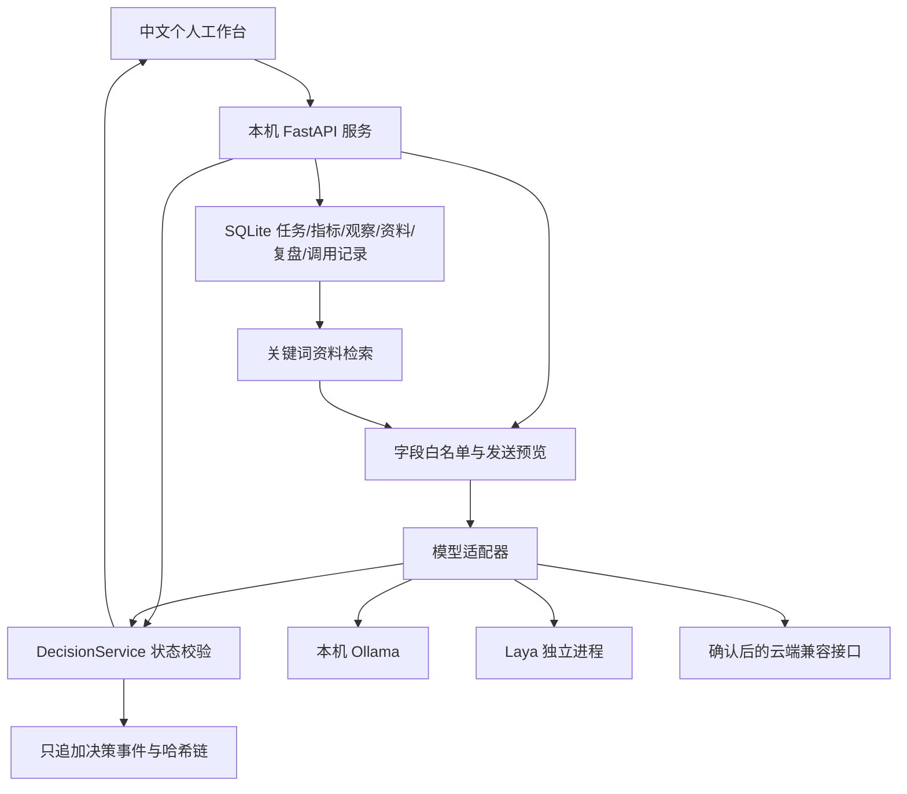

# Q-One 完整蓝图 · v0.3

日期：2026-10-24。本文描述已实现的个人应用，并单独列出后续研究。核心主旨是“万事万物皆可量化”：把可观察的问题变成有定义、有来源、有时间和反馈的记录；无法可靠测量的部分保持未知。

## v0.3 主动推荐入口

主要入口已改为“目标 → 自动推荐 → 今日行动 → 下一步”。保存目标和完成标准后，后台读取有界的目标、待办、完成记录、近期观察及相关笔记，先提供明确标记的规则建议，再调用本地模型完善小步骤。推荐不写入人工选择事件，也不生成行动成功概率。

服务生命周期管理后台线程：启动即检查、成功写入后唤醒、空闲每30秒检查一次。相同输入和模型配置缓存，默认6小时重评；失败后5分钟再试。人工决策与自动推荐共享模型锁，防止并发占用资源。过时输入或配置对应的模型结果丢弃并留痕。

采纳前校验具体推荐内容的摘要；推荐已更新时重新审阅。采纳后创建或聚焦已有任务，避免重复；完成该目标的行动后更新阶段，允许推荐下一步。当天计划时间扣除已采纳投入，忽略的候选当天隐藏，输入阶段变化或跨日后重新检查。用户仍需明确标记目标完成，系统不靠任务勾选猜测长期目标是否达成。

新增 goals 与 suggestions 数据表；备份升级v2，兼容读取旧v1。模型调用记录保留有界输入快照、结构化输出、来源与使用信息，便于核查。详情及验证限制见 AUTOMATIC_RECOMMENDATIONS.zh-CN.md。

## 1. 产品目标与交付范围

面向个人学习、项目安排及日常选择，建立可反复使用的闭环：问题、选项、事前成功标准、初始判断、外部参考、实际选择、行动、观察、结果、复盘。最小使用单位是一个具体选择，例如“今晚30分钟做练习还是整理资料”，而不是“我的人生价值是多少”。

这套独立实现的入口为 q-one-life。q-one-core 提供状态与事件账本，q-one-agent 提供模型适配；它们共同组成一个产品。用户提出的另外两个完整方案可以使用不同架构，不能用三个内部仓库冒充三套成品。

v0.3 在上述主动推荐入口上保留中文网页、SQLite、事件哈希链、三个推理接口、个人资料检索、指标观察、任务、复盘和备份恢复。没有训练自有大模型、自动执行外部任务、多用户协作或日历同步。

## 2. 总体架构

本机网页只与本机服务交互，由后端向模型发送当前决策字段及选中的资料片段。不会默认发送全部观察、全部历史、其他任务或接口密钥。基础应用不依赖远程数据库、在线字体或前端 CDN。

## 3. 决策契约与状态机

决策包含 schema_version、decision_id、question、domain、success_criterion、deadline、risk、reversible、options、context。截止时间必须有时区，选项 ID 唯一，选项数为2—8，预计成本为有限非负数。

状态：created → baseline_recorded → recommended（可跳过）→ decided → resolved。未结算的选择可带理由进入 abandoned。模型只能在初始判断已保存、最终选择尚未确认时建议一次。最终选择不能被重复结算或悄悄改写；新的问题应建立新决策。

每个状态转移都在同一文件锁内读取、校验、追加，阻止两个并发请求重复保留初始判断。高影响或不可逆决策必须填写人工理由，所有建议都需要人工确认。界面保存创建与初始判断是两个事件；若进程恰好中断，created 记录可以在详情页补录初始判断。

确认选择后生成一个以 decision_id 为关联键的任务，刷新或重启不会重复生成。任务勾选只反映清单完成情况；对照事前成功标准的结果另行记录为 yes、no、partial、unknown。放下一个已决定事项时移除其关联任务，事件历史继续保留。

## 4. 模型层

| 路径 | 作用 | 资源与边界 |
|---|---|---|
| Laya | 对给定选项作类型化选择 | laya 0.4.14；多语言权重固定提交；默认CPU、一次一进程；无生成式解释 |
| Ollama | 基于问题和资料生成结构化建议与简要依据 | 本地HTTP接口，默认 qwen3:8b；实际模型名称由用户选择 |
| 云端兼容接口 | 使用用户配置的远程生成模型 | 需支持 Chat Completions JSON 输出；预览确认后发送 |

统一输出是给定 option_id、0—1 推荐强度、简要依据、来源、人工确认要求。未知选项、非有限分数、无依据或响应格式错误均拒绝，不以模拟结果替代。

推荐强度没有个人任务校准，不转换为行动成功概率。success_probability 在这三条真实适配路径上固定为空；报告不会用它伪造 Brier 或 ECE。Laya 不生成依据，页面明确说明只进行了类型化比较。

Laya 返回输入截断或选项内容合并时，适配器拒绝该建议，提示缩短内容或换模型。Ollama 使用4096上下文预算，长文本仍可能受服务端截断影响；当前没有完整的跨模型 token 预算预检，重要问题应使用简短背景并审阅输出。

同时只允许一个模型请求，减少本机资源竞争。模型调用超时、连接失败或格式错误保留失败记录，用户可以重试或直接手动决定。本版本没有自动路由、无声切换模型或模型自动执行权。

## 5. 数据模型与测量

| 数据 | 存储 | 更新方式 |
|---|---|---|
| 决策及过程 | decisions.jsonl | 只追加；事件seq、prev_hash和hash校验 |
| 目标 | SQLite goals | 可调整完成标准、优先级、状态与期限 |
| 自动建议 | SQLite suggestions | 推荐版本、来源、人工反馈；调用记录保留输入输出 |
| 任务 | SQLite tasks | 新建、勾选；决策关联去重 |
| 指标定义 | SQLite metrics | 创建时固定版本；变更定义新建指标 |
| 观察 | SQLite observations | 原始记录保留，通过supersedes更正 |
| 用户资料 | SQLite documents | 粘贴正文及来源，可移除 |
| 模型调用 | SQLite runs | 来源、输入摘要哈希、耗时、使用信息、引用片段快照或错误 |
| 复盘 | SQLite reviews | 用户文字与当时的统计快照 |
| 模型配置 | settings.json | 仅本机；密钥不回传页面和备份 |

设某指标范围为[l,h]、观察为x。越高越好：z=(x-l)/(h-l)；越低越好：z=1-(x-l)/(h-l)；接近目标t：z=max(0,1-|x-t|/max(t-l,h-t))。窗口内有效观察的z取算术平均。覆盖为min(1,有效记录数/用户期望记录数)。

只统计未被更正、位于所选7/30/90天内的观察。缺失时score与latest_value为空，n为0。不同量纲、不同人的指标不合并；global_score恒为空。期望次数由用户按窗口解释，切换窗口不会自动把7次放大为30次。观察频率可以改变均值，分数不证明因果或生产力提升。

## 6. 资料与证据

个人资料通过英文词及中文连续二字片段匹配，最多选择3份，每份提供前1800字片段。用户资料始终标为未独立核实，不能把检索命中当作来源真实或结论正确。若证据在文档后半部分，当前截取可能遗漏，应拆成短笔记。

研究库已有论文与开源来源登记、BibTeX及中文融合路线，位于 q-one-core/literature。技术吸收遵循：来源登记 → 可复述机制 → 明确适用问题 → 最小实现 → 固定输入测试 → 比较基线 → 保留失败。已有来源数量不等于每项思想都已实现。

先前并行添加的理论综合或预注册文档属于研究提案；本版本工程验收不验证其中的数学或效果论断。不能把集成现成模型称为训练了新模型。

## 7. 验收与工程交付

工程检查分三层：自动化状态及接口测试、真实模型连接测试、浏览器操作检查。测试夹具验证应用协议；真实调用验证当前机器的路径；二者都不能证明普遍决策质量。详见 ACCEPTANCE.zh-CN.md 和原始JSON回执。

固定内部依赖提交、提供一个入口安装脚本、启动命令、停止方式、私有数据目录和恢复方式。公开仓库只发布代码、文档及明确标记的合成验收工件。

## 8. 后续里程碑与完成条件

1. **真实个人试用**：用户自行选择一类低影响重复决策，连续记录基线、实际选择、结果和使用负担。完成条件是输入完整、能重放、未知未被填补，尚无效果提升结论。
2. **对比研究**：预先冻结任务、观察窗口和评分规则，对比人工记录、生成模型、Laya与混合方案。控制先后顺序影响及结果选择偏差；只有实际观察的行动结果能计分。
3. **证据升级**：改进片段定位、引用跳转和来源版本；在公开小测试集上核查引用是否支持建议，再决定是否引入嵌入或GraphRAG。
4. **模型路由**：取得可比较的真实调用与错误记录后，根据延迟、成本、拒答及任务类型路由。没有测量之前不设“最优模型”榜单。
5. **个人适应**：先更新可审阅规则和提示，再考虑偏好学习或微调。偏好拟合与行动收益分开评估。
6. **集成扩展**：增加日历、设备数据或外部行动时，逐项设计权限、撤销与人工确认；不沿用本机单用户边界直接发布到公网。

每个阶段都允许结论为“没有收益”或“记录负担太大”，据此简化系统。完整人生系统应逐步扩展适用范围，而不能从一次连接测试外推到健康、财务或人生成功。
