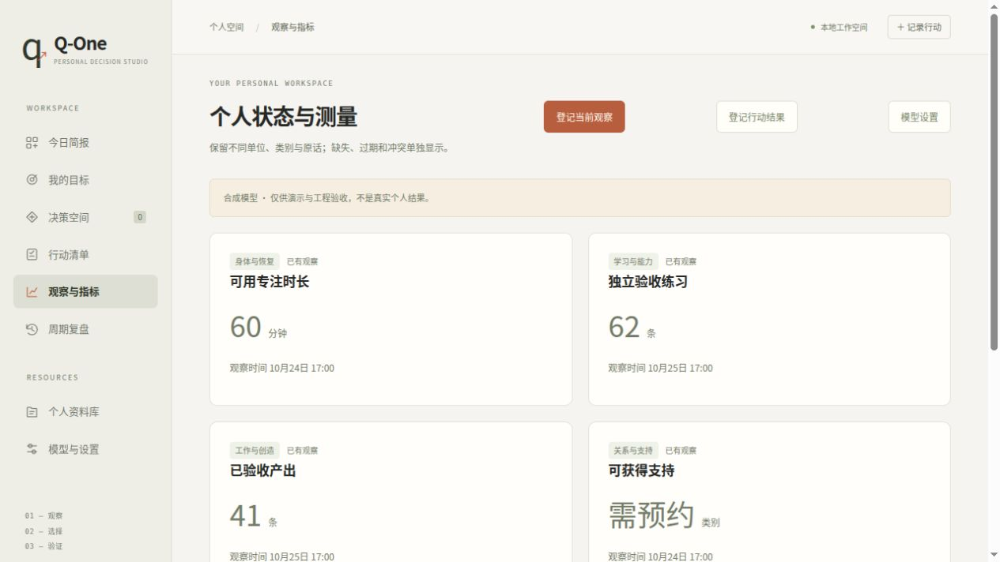

# 本地观察与行动结果登记 0.7

本版把“真实结果如何进入现有学习内核”补成可使用的流程：在「观察与指标」中登记当前数量观察，之后登记固定窗口的行动与结果，不再要求手改整个模型JSON。基础测量定义、单位、行动投入和结果窗口仍先由个人模型明确声明；没有定义的对象保持未知。

之前已接入的学习器能读取`episodes`，应用却只能导入整份模型。多轮合成模型对照没有带来可默认采用的预测器，因此本轮优先修复持续观察和结果反馈这一实际缺口。新增的是数据登记功能，没有采用此前未过关的遗忘或双尺度研究模型，也没有证明真实人生收益。

## 如何使用

1. 在「模型设置」导入自己的测量/行动模型，核对定义、单位、固定结果窗口、投入与目标取舍。合成示例空间有明确标记，演示结果不能冒充个人证据。
2. 点击「登记当前观察」，填写实际测量时刻、按原口径得到的数量和来源。不清楚的量保持未知。系统在本机记录收到数据的真实时间；今天补录的观察不能变成昨天已经知道的事实。
3. 到达结果窗口后点击「登记行动结果」，填写实际结果测量时刻，选择窗口内完整执行的行动。系统按原窗口长度回查当时已知、未过期、无冲突的事前观察，并展示行动定义、完整时长和资源投入。
4. 核对已有事前值，输入该结果时点的全部数量与来源，明确确认执行情况。保存后，新证据进入原有模型版本链，后续预测可以读取；不足样本、新行动支持不足或状态未知时仍拒绝推荐。

学习窗口描述一段时间里的前后变化，不等于某个任务花费的分钟数。未勾选的行动表示未执行这些行动；只完成一部分时不能把它登记为完整执行。部分执行的真实数量可以单独登记为观察，当前预测器还不能据此学习连续投入的效果。

## 数据和时间约束

- 结果时刻决定`ended_at`，`started_at = ended_at - horizon_days`；不把不规则结果时点强行塞入另一结果窗口。观察间隔、测量口径变化和因果混杂仍需单独研究。
- 事前值必须引用已有不可变观察ID，且该值在窗口开始前已经登记。缺失、过期、冲突、区间中点或已被更正的事前值不能自动补造。不能今天先登记基线，再把它用于昨天开始的窗口。
- 新观察的`recorded_at`由服务端设置，客户端不能提交它；未来结果、额外置信度字段、把类别/原话变成分数、布尔值冒充数量、超出量表范围或不完整结果都被拒绝。
- 执行记录绑定本次确认的完整行动定义哈希；新增数据不改变资源承诺，不替待办自动扣费、释放时间或标记完成。勾选待办完成和采纳建议本身不会创建学习标签。
- 同一登记ID重复请求不重复写入；修改其数值或来源后重用ID会拒绝。重叠结果窗口被拒绝，避免把同一段结果重复计数。窗口重叠限制是本地采集的保守规则，不是观测独立性的证明。
- 保存使用当前版本的比较交换，防止并发覆盖；校验失败不会只写一半观察。新增记录、原始版本链和完整资源承诺一起进入既有v3私有备份，恢复时继续校验。

新数据属于`user_report`，是明确来源的本人报告，尚未独立核实；确认复选框不是验证真人身份或执行真实性的证明。当前更正已登记观察或改变测量定义仍需经过模型版本导入，不能覆盖已有结果。旧导入文件中的来源和时间也不是由新接口追溯认证的。

## 接口

所有写入沿用原有本地同源边界与`X-QOne-Client: web`头，不增加云端依赖或遥测。

| 接口 | 作用 | 重要约束 |
|---|---|---|
| `POST /api/system/observations` | 追加当前学习配置涉及的数量观察，不创建执行记录 | `event_id,parent_revision,observed_at,values,source` |
| `POST /api/system/outcomes/preview` | 只读核查窗口、事前引用、投入与行动版本 | `action_ids,observed_at`；返回`eligible,issues,before,revision,action_definition_sha256` |
| `POST /api/system/outcomes` | 原子追加结果观察与执行记录，产生新模型版本 | 需预览返回的版本、事前引用、行动哈希，再加`event_id,outcomes,source,execution_confirmed=true` |

结果请求不接收`kind`、`recorded_at`或任意评分字段。结果是绝对观察值，变化量由前后观察计算，不能把建议预测值写成已经实现的变化。

修复了保存后立即刷新可能仍显示旧值的问题：决策截点取稳定分钟边界与当前已收到证据时间的较晚值，且不超过当前时钟。没有新数据时重复轮询仍保留稳定提案；新收到的数据不会被向前挪时间来装作更早已知。

## 来源与采用边界

研究了[MLflow的类型化评估与来源记录](https://github.com/mlflow/mlflow/blob/6620852843727e89a185b117d8297756eb9f1f7b/mlflow/entities/assessment.py)以及[Agent Lightning v1.0](https://arxiv.org/abs/2608.17528v1)。借鉴的是把反馈绑定到具体版本/记录、区分来源、将交互采集与训练分开的结构，没有复制实现或安装其服务。

MLflow的反馈包括评审分数、代码检查和模型判断；这些不能直接充当人生结果数量。Agent Lightning的论文/README报告指令、检索和代码任务的RL，不是个人生活长期决策验证。本项目没有复现其基准、训练RL策略或把其性能数字转用于Q-One。

核验记录：[固定版本、许可证与阅读范围](research/outcome-source-probes.json)。本轮搜索式：`site.github.com mlflow logged model assessment feedback trace human feedback`、`site.github.com agentlightning OpenTelemetry reward trace Microsoft`、`site.github.com gerdm rebayes-mini changepoint regression online Bayesian`。第三个检索仅作候选线索；未再按固定周期叠加新的未经验证预测模型。搜索没有可靠总命中数，未把展示条数当作总数。

## 验证、限制与恢复

功能协议在实现前冻结为commit `25a3a3603efe07916149a1d70dbe9f1a0d01751a`；[基线](../artifacts/outcome-intake/v1/baseline.json)中两个结果接口均不存在。[协议](../artifacts/outcome-intake/v1/protocol.json) SHA-256为`d1603019af4ca11237851c3b74cef6cfc022ff94d16675eed1b730daa40b81da`。

测试覆盖初始观察→稍后结果→学习器读取、尚未到达的结果不影响过去预测、少样本拒绝、完整/部分执行、量表错误、事前值缺失/更正、重复登记、并发版本、资源不变、备份/重启和同分钟可见性。浏览器在独立合成空间实际提交了一条结果，确认学习记录从96条变为97条、页面显示输入值，并检查重叠窗口被拒绝。安装包结果记录在[版本工件](../artifacts/outcome-intake/v1/)；远端CI以本次提交关联的GitHub Actions检查为准。

复现：安装本版后在仓库根目录运行`python -m unittest discover -s tests -v`，并以`node --check < src/qone_life/static/app.js`检查前端语法。测试全部使用临时合成空间，不调用共享模型服务。工件保存样例、来源、功能收据与输入/源码哈希；时间相关的版本ID不要求不同运行之间逐字节相同。

功能可用不能证明预测质量、因果效应或人生收益。下一瓶颈是持续得到口径一致、质量可核验的前瞻观察，并在已知合成生成族以外检验稳定/变化识别与噪声模型。回退应用版本前先导出v3私有备份；原有核心预测协议与依赖版本保持不变，旧应用可读取已保存的兼容模型记录。
